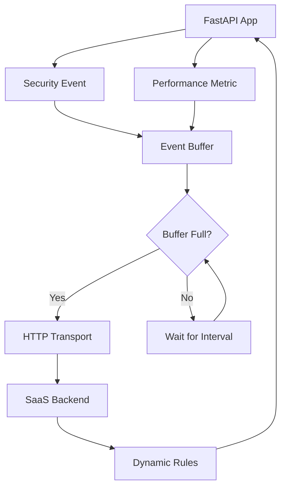

# Getting Started

This comprehensive guide provides a systematic approach to deploying Guard Agent within your application infrastructure. Upon completion, you will have established a production-ready security telemetry pipeline capable of real-time threat detection and response.

## Architecture Overview

The Guard Agent operates as an intelligent telemetry layer within your security infrastructure, providing:

1. **Automated Collection** - Captures security events and performance metrics through deep integration with FastAPI Guard middleware
2. **Intelligent Buffering** - Implements multi-tier data management with memory and persistent storage options for optimal performance
3. **Reliable Transmission** - Ensures guaranteed delivery of telemetry data through enterprise-grade transport mechanisms
4. **Dynamic Configuration** - Enables real-time security policy updates without service interruption

## Prerequisites

### System Requirements

- **Python Runtime**: Version 3.10 or higher (3.11+ recommended for optimal performance)
- **Package Installation**: Guard Agent via pip ([Installation Guide](../installation.md))
- **Application Framework**: Existing or new FastAPI application
- **Authentication**: Valid API credentials from the FastAPI Guard management platform
- **Optional Components**: Redis 6.0+ for persistent buffering in production environments

## Implementation Guide

### Step 1: Standard Integration Pattern

The recommended deployment leverages FastAPI Guard's native agent support for automatic telemetry collection:

```python
# main.py
from fastapi import FastAPI
from guard import SecurityConfig, SecurityMiddleware

app = FastAPI(title="My Secure API")

# Configure FastAPI Guard with agent enabled
config = SecurityConfig(
    # Basic security settings
    auto_ban_threshold=5,
    auto_ban_duration=300,
    enable_rate_limiting=True,
    rate_limit=100,
    rate_limit_window=60,

    # Enable agent for telemetry
    enable_agent=True,
    agent_api_key="your-api-key-here",      # Replace with your actual API key
    agent_project_id="your-project-id",     # Replace with your project ID
    agent_endpoint="https://api.guard-core.com",  # Default SaaS endpoint

    # Agent configuration
    agent_buffer_size=100,                  # Buffer up to 100 events
    agent_flush_interval=30,                # Send data every 30 seconds
    agent_enable_events=True,               # Enable security event collection
    agent_enable_metrics=True,              # Enable performance metrics

    # Enable dynamic rules from SaaS
    enable_dynamic_rules=True,
    dynamic_rule_interval=300,              # Check for rule updates every 5 minutes
)

# Add security middleware - agent starts automatically
app.add_middleware(SecurityMiddleware, config=config)

@app.get("/")
async def root():
    return {"message": "Hello, World!"}

@app.get("/health")
async def health():
    return {"status": "healthy", "agent_enabled": config.enable_agent}
```

With this configuration, the agent provides:
- Comprehensive security event capture across all middleware operations
- Real-time performance telemetry with sub-second granularity
- Automatic synchronization of security policies from the management platform

### Step 2: Configuration Architecture

The agent configuration is seamlessly integrated within FastAPI Guard's SecurityConfig, providing a unified interface for all security settings:

```python
from guard import SecurityConfig

config = SecurityConfig(
    # Agent-specific settings (prefix: agent_)
    enable_agent=True,                    # Enable/disable agent
    agent_api_key="your-api-key",         # Your SaaS platform API key
    agent_project_id="your-project-id",   # Your project identifier
    agent_endpoint="https://api.guard-core.com",  # SaaS platform endpoint
    agent_buffer_size=100,                # Max events in memory buffer
    agent_flush_interval=30,              # Seconds between data transmissions
    agent_enable_events=True,             # Collect security events
    agent_enable_metrics=True,            # Collect performance metrics
    agent_retry_attempts=3,               # HTTP retry attempts
    agent_timeout=30,                     # HTTP request timeout

    # Dynamic rules settings
    enable_dynamic_rules=True,            # Enable dynamic rule fetching
    dynamic_rule_interval=300,            # Seconds between rule updates

    # Standard FastAPI Guard settings
    enable_rate_limiting=True,
    enable_ip_banning=True,
    enable_penetration_detection=True,
    # ... other security settings
)
```

### Step 3: Data Flow Architecture

The agent implements a sophisticated data pipeline designed for reliability and performance:



**Pipeline Components:**

1. **Event Generation**: Security violations and performance metrics are captured at the middleware layer
2. **Intelligent Buffering**: Multi-tier buffering system optimizes for both latency and throughput
3. **Batch Transmission**: Efficient batching algorithms minimize network overhead while maintaining low latency
4. **Backend Processing**: Cloud-based analytics engine processes telemetry for threat detection and policy updates
5. **Policy Synchronization**: Updated security rules are atomically applied without service disruption

### Step 3.1: Outgoing Body Compression

The agent gzip-compresses outgoing telemetry batches whose JSON body exceeds the agent's `compression_threshold` bytes (default 1024). When compression applies the request is sent with the `Content-Encoding: gzip` header. Smaller batches are sent as plain JSON to avoid the encode/decode cost.

Why it matters:

- **Bandwidth.** A typical batch of 100 security events compresses 5x to 10x. Customers running guard-agent inside high-traffic services see meaningful egress savings, especially near the safe `buffer_size` ceiling of 100 events. Keep `buffer_size` at 100 or lower and tune `flush_interval` instead; a larger `buffer_size` risks a batch that exceeds the 256 KiB SaaS body cap.
- **Tail latency.** Smaller payloads mean fewer TCP round-trips and faster TLS writes. Useful when the agent shares a network path with the application's own traffic.
- **Cost.** When the SaaS endpoint is a managed gateway (CloudFront, Cloudflare, GCP HTTP(S) LB), compression cuts metered egress and request size charges.

Compatibility:

| Endpoint | Default `compression_enabled=True` |
|---|---|
| **Guard Core SaaS (`https://api.guard-core.com`)** | Works as-is. The SaaS decompresses gzip request bodies via its `GzipRequestMiddleware` before pydantic validation. No customer action required. |
| **Custom ingestion endpoint without gzip request decoding** | Build the agent with `AgentConfig(..., compression_enabled=False)`. Most plain FastAPI / Flask / Django apps do not auto-decompress gzip *request* bodies; compressed batches will fail body parsing on those backends. |

Tuning is done on `AgentConfig` directly (the agent transport owns compression; `SecurityConfig` does not forward these knobs). This means there is currently no way to change compression settings for an agent driven by `enable_agent=True` on `SecurityConfig`. The snippet below only applies to a standalone agent in a process with no adapter middleware enabling the agent through `SecurityConfig`:

```python
from guard_agent import guard_agent, AgentConfig

config = AgentConfig(
    api_key="your-api-key",
    project_id="your-project-id",
    compression_enabled=True,    # Default; gzip large batches
    compression_threshold=1024,  # Skip gzip for bodies smaller than 1 KiB
)
agent = guard_agent(config)
```

Lower the threshold (e.g. 256) for chatty deployments where most batches are tiny but still worth compressing. Raise it (e.g. 4096) for batches that are mostly small-and-frequent and you would rather save the gzip CPU.

If you self-host an ingestion endpoint, the SaaS-side middleware lives in `guard_core_api.core.gzip_request_middleware.GzipRequestMiddleware`. Any backend with an equivalent middleware (decompresses `Content-Encoding: gzip` before body parsing, returns 400 on malformed gzip) will be compatible with the default agent setting.

### Step 4: Advanced Security Controls

FastAPI Guard's decorator system provides granular security controls with automatic telemetry integration:

```python
from fastapi import FastAPI
from guard import SecurityConfig, SecurityMiddleware, SecurityDecorator

app = FastAPI(title="My Secure API with Enhanced Security")

# Configure with agent
config = SecurityConfig(
    enable_agent=True,
    agent_api_key="your-api-key",
    agent_project_id="your-project-id",
    # block_countries needs a geo source
    ipinfo_token="your_ipinfo_token_here",
    # ... other settings
)

guard = SecurityDecorator(config)

app.add_middleware(SecurityMiddleware, config=config)
app.state.guard_decorator = guard

@app.get("/")
async def root():
    return {"message": "Hello, World!"}

@app.get("/public")
@guard.rate_limit(requests=5, window=60)
async def public_endpoint():
    """Rate limited endpoint - events sent automatically to agent."""
    return {"message": "This endpoint has rate limiting"}

@app.get("/admin")
@guard.require_ip(whitelist=["127.0.0.1", "10.0.0.0/8"])
@guard.rate_limit(requests=2, window=300)
async def admin_endpoint():
    """Admin endpoint with IP restrictions - all violations logged to agent."""
    return {"message": "Admin access granted"}

@app.get("/api/sensitive")
@guard.rate_limit(requests=3, window=600)
@guard.block_countries(["CN", "RU"])
async def sensitive_api():
    """Sensitive API with multiple security layers."""
    return {"message": "Sensitive data accessed"}
```

### Step 5: Deployment Validation

Comprehensive testing ensures proper agent operation:

1. **Application Startup**:

    ```bash
    uvicorn main:app --reload --log-level info
    ```

2. **Functional Verification**:

    ```bash
    # Baseline connectivity test
    curl http://localhost:8000/

    # Security event generation
    curl -X POST http://localhost:8000/api/sensitive -d "test_injection"

    # Performance metric generation
    curl http://localhost:8000/api/heavy-operation

    # Agent health verification
    curl http://localhost:8000/health
    ```

3. **Log Analysis**: Verify proper initialization:

    ```text
    INFO:     FastAPI Guard security middleware initialized
    INFO:     Agent telemetry pipeline established
    INFO:     Dynamic rule synchronization active
    ```

**Automatic Event Categories**: the agent captures:

- Rate limiting violations with request metadata
- IP-based access control events
- Geographic restriction violations
- Pattern-based threat detection
- Authentication and authorization failures
- Custom security rule triggers

## Deployment Patterns

### Environment-Specific Configuration

**Development Environment:**

```python
# config_dev.py
from guard import SecurityConfig

dev_config = SecurityConfig(
    # Development agent settings
    enable_agent=True,
    agent_api_key="dev-api-key",
    agent_project_id="my-app-dev",
    agent_buffer_size=10,          # Small buffer for immediate feedback
    agent_flush_interval=5,        # Frequent flushes for testing

    # Security settings for dev
    enable_rate_limiting=True,
    rate_limit=1000,               # Higher limits for testing
    enable_ip_banning=False,       # Disable banning in dev
)
```

**Production Environment:**

```python
# config_prod.py
from guard import SecurityConfig

prod_config = SecurityConfig(
    # Production agent settings
    enable_agent=True,
    agent_api_key="prod-api-key",
    agent_project_id="my-app-prod",
    agent_buffer_size=100,         # Safe ceiling for the 256 KiB SaaS body cap
    agent_flush_interval=60,       # Less frequent flushes
    agent_retry_attempts=5,        # More retries for reliability

    # Security settings for production
    enable_rate_limiting=True,
    rate_limit=100,
    enable_ip_banning=True,
    auto_ban_threshold=5,
    enable_penetration_detection=True,

    # Enable dynamic rules in production
    enable_dynamic_rules=True,
    dynamic_rule_interval=300,
)
```

### Fault Tolerance

The agent implements comprehensive error handling to ensure application stability:

```python
from fastapi import FastAPI
from guard import SecurityConfig, SecurityMiddleware

app = FastAPI()

# Even if agent fails, your app continues running
config = SecurityConfig(
    enable_agent=True,
    agent_api_key="your-api-key",
    agent_project_id="your-project-id",
    # ... other settings
)

try:
    app.add_middleware(SecurityMiddleware, config=config)
    logger.info("Security middleware initialized with telemetry pipeline")
except Exception as e:
    logger.warning(f"Telemetry initialization failed: {e}")
    # Application continues with security enforcement but without telemetry
```

### Custom Event Handling (Advanced)

For scenarios requiring custom business logic events beyond standard security violations, with no FastAPI Guard middleware enabling the agent in the same process. Do not combine this with the `enable_agent=True` `SecurityConfig` pattern shown earlier in this guide. `guard_agent()` dispatches to `SyncGuardAgentHandler` from sync module-load context but to `GuardAgentHandler` from the middleware's async init, so the two are separate singletons and only the middleware's instance receives traffic:

```python
from contextlib import asynccontextmanager

from fastapi import FastAPI, Request
from guard_agent import guard_agent, AgentConfig, SecurityEvent
from guard_agent.utils import get_current_timestamp

# Get agent instance (singleton)
config = AgentConfig(
    api_key="your-api-key",
    project_id="your-project-id",
)
agent = guard_agent(config)

# Manually start/stop if not using FastAPI Guard
@asynccontextmanager
async def lifespan(app: FastAPI):
    await agent.start()
    yield
    await agent.stop()


app = FastAPI(lifespan=lifespan)

# Send custom events
@app.post("/custom-action")
async def custom_action(request: Request):
    # Your business logic here

    # Send custom event
    event = SecurityEvent(
        timestamp=get_current_timestamp(),
        event_type="custom_rule_triggered",
        ip_address=request.client.host,
        action_taken="logged",
        reason="Custom business rule",
        endpoint="/custom-action",
        method="POST",
        metadata={
            "custom_field": "custom_value",
            "user_agent": request.headers.get("user-agent", ""),
        }
    )
    await agent.send_event(event)

    return {"status": "success"}
```

## Integration Testing

Create a simple test to verify your integration:

```python
# test_integration.py
import pytest
from httpx import AsyncClient
from main import app

@pytest.mark.asyncio
async def test_fastapi_guard_with_agent():
    """Test that FastAPI Guard with agent works correctly."""

    async with AsyncClient(app=app, base_url="http://test") as client:
        # Test normal endpoint
        response = await client.get("/")
        assert response.status_code == 200

        # Test rate limited endpoint
        for i in range(6):
            response = await client.get("/public")
            if i < 5:
                assert response.status_code == 200
            else:
                # Should be rate limited
                assert response.status_code == 429

        # Test IP restricted endpoint
        response = await client.get("/admin")
        # Should work from localhost
        assert response.status_code in [200, 403]

        # All security events are automatically sent to the agent
```
